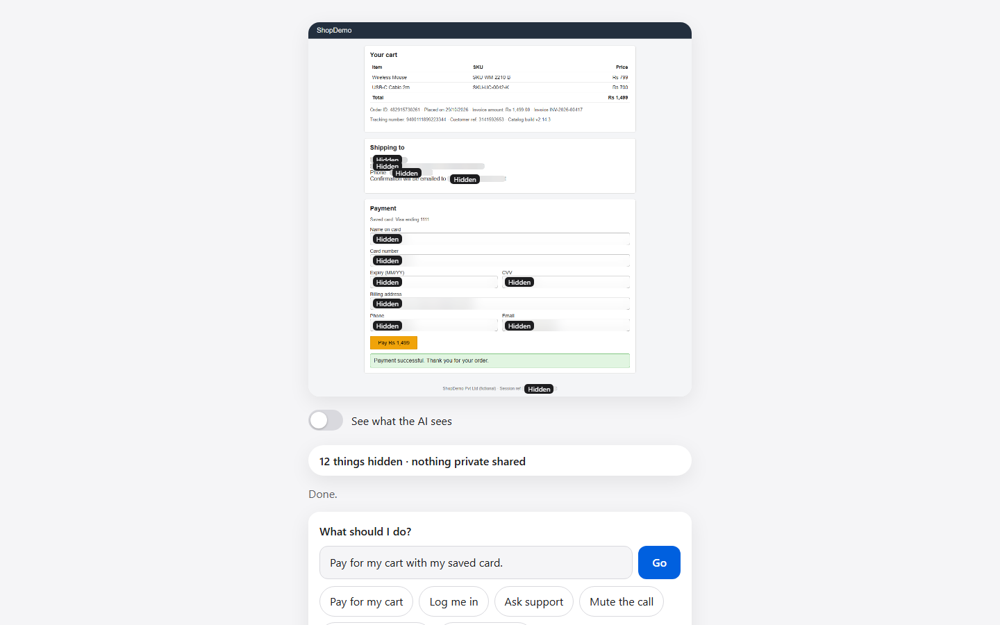
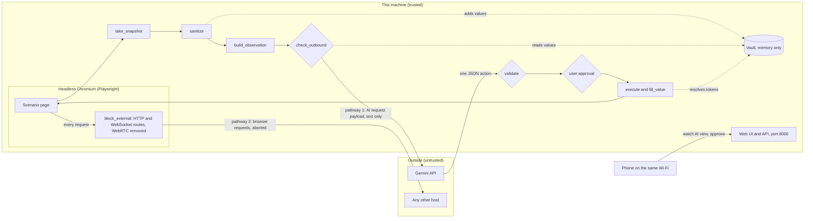

# PrivacyLens

PrivacyLens is a browser agent that finds sensitive data on a web page on this machine and sends the AI model only a sanitized text view of the page, with private values replaced by placeholders. The AI plans with tokens such as `{{CARD#1}}`, and the local code types the real value into the page only after validation and, for sensitive steps, the user's approval.

Built for PECATHON'26, problem statement PS-004. All data in this repository is synthetic.




A one-file visual overview with screenshots, the pipeline and setup steps: [docs/overview.html](docs/overview.html) (open it in a browser).

## Contents

1. [Architecture and data flow](#1-architecture-and-data-flow)
2. [Setup and configuration](#2-setup-and-configuration)
3. [Detection and sanitization methodology](#3-detection-and-sanitization-methodology)
4. [AI integration and action validation](#4-ai-integration-and-action-validation)
5. [Security assumptions, data retention and known limitations](#5-security-assumptions-data-retention-and-known-limitations)
6. [Evaluation methodology and results](#6-evaluation-methodology-and-results)
7. [Run the tests](#7-run-the-tests)
8. [Try the leak test and the injection demo](#8-try-the-leak-test-and-the-injection-demo)
9. [Tools and credits](#9-tools-and-credits)

## 1. Architecture and data flow



One step of the agent loop (`app/agent.py`):

1. `take_snapshot` reads the page: elements, visible text, `title`/`alt`/`data-*` attribute text, the accessibility tree, a full-page screenshot and the pixel boxes of sensitive text.
2. `sanitize` replaces each sensitive value with `[REDACTED:TYPE#n]`, stores the real value in the vault, and paints the sensitive regions of the screenshot solid black.
3. `build_observation` builds the JSON the AI receives. Saved details appear only as `{{TYPE#n}}` tokens with their kind.
4. `check_outbound` scans the exact outbound string (system prompt plus observation). Any hit or any exception blocks the step.
5. The AI replies with one JSON action.
6. `validate` checks the action. Sensitive or irreversible steps wait for the user's approval.
7. `execute` acts in the browser. `fill_value` swaps tokens for real values at this point only.

### Trust boundaries

| Boundary | Treatment |
|---|---|
| Page to agent | Page content is untrusted. It may hide instructions or try to send data out. |
| Agent to AI service | Only the payload that passes `check_outbound` leaves. |
| AI service to agent | The reply is untrusted until `validate` accepts it. |
| Browser to network | Every request of the browser context is routed; non-local ones are aborted. |
| UI and API to the network | The server listens on all interfaces for the phone. Settings, runs, raw page data and the leak test are limited to this machine (`server.local_only`). |

The vault, the raw snapshot and the executor are trusted and local.

### The two covered transmission pathways

1. **AI request payload.** Built by `prompts.build_observation` from sanitized data only, checked by `guard.check_outbound` before `LLM.next_action` is called. The payload is text. The blacked-out screenshot is shown to the user but is not sent to the model.
2. **Browser network requests.** `executor.block_external` routes every HTTP request (`context.route`) and every WebSocket (`context.route_web_socket`) of the browser context. Only `localhost`, `127.0.0.1`, `::1` and `data:`, `blob:`, `about:` URLs continue. Everything else is aborted and only the site name is logged. WebRTC cannot be routed this way, so an init script removes `RTCPeerConnection` and related constructors from every page, and Chromium is started with `--force-webrtc-ip-handling-policy=disable_non_proxied_udp` as a second lock.

Leakage claims in this README cover these two pathways and the tested scenarios only.

## 2. Setup and configuration

Requirements: Python 3.11 or newer (our measured runs used 3.13), about 1 GB of disk for the Playwright browsers, internet for the first install. After that, Mock mode runs fully offline.

### Windows

```bat
py -3 -m venv .venv
.venv\Scripts\activate
pip install -r requirements.txt
playwright install chromium
copy .env.example .env
python -m app.server
```

`run.bat` runs the same steps. Known issue: the activate line in the current `run.bat` contains a control character instead of `\a`, so it may fail to activate the virtual environment. Use the commands above until it is fixed.

### macOS and Linux

```sh
./run.sh
```

or by hand:

```sh
python3 -m venv .venv
. .venv/bin/activate
pip install -r requirements.txt
playwright install chromium
cp .env.example .env
python -m app.server
```

On Linux, Playwright may also need system libraries: `playwright install-deps` (needs sudo).

Then open http://localhost:8000 on the computer.

### Configuration (.env)

| Variable | Meaning |
|---|---|
| `GEMINI_API_KEY` | Key for the Gemini API. Leave empty to use the offline Mock only. |
| `GEMINI_MODEL` | Model name. Empty means `gemini-3.5-flash-lite`. |
| `GEMINI_FALLBACK_MODELS` | Comma-separated models tried after `GEMINI_MODEL` when it is rate limited or unreachable. Not set means `gemini-3.6-flash,gemini-3.5-flash`. Set it to an empty value to turn fallback off. Commented out in `.env.example`. |
| `PRIVACYLENS_PORT` | Optional environment variable, default 8000. |

The key is read only from `.env`, sent only in the `x-goog-api-key` header, and never logged.

Check that the key and model work before a demo:

```sh
python scripts/check_gemini.py
```

It sends one harmless request per model and prints which model answered, never the key.

### Mock or Gemini

- **Mock (offline)**: a scripted planner in `app/llm.py` that reads the same sanitized observation Gemini would get. Used by default when no key is present, and by the tests and the eval.
- **Gemini**: used only when `GEMINI_API_KEY` is set. Choose it under How it works > AI choice. Requests time out after 30 s. On network errors, HTTP 429 and 5xx it moves on to the next model in the fallback chain. `GeminiLLM` asks `GEMINI_MODEL` first, then each model in `GEMINI_FALLBACK_MODELS`. It makes up to 3 rounds over the list, waiting 2 s and then 6 s between rounds (longer if the service asks, plus up to 1 s of jitter). It honours `Retry-After` and the `retryDelay` in a 429 body, and drops a model for the rest of the run when its free-tier daily quota is used up. The guard, validator and approvals are unchanged; every model gets the same already-checked payload. The audit log names the model that answered each call: "the AI answered (<model>)". The first `ask_user` of a run is sent back to the AI with feedback instead of stopping the run.

Why: the only cause of Gemini failures we measured was HTTP 429 rate limiting on the free tier.
- **Offline test AI that obeys the page**: a Mock that follows the injection page's hidden instructions on purpose, to show the validator stopping it.

Privacy rules (per-type toggles, hints, "Always hide..." patterns) are saved in `config/rules.json`.

### Phone as approval remote

1. Put the phone on the same Wi-Fi as the computer.
2. Find the computer's IP address (`ipconfig` on Windows, `ipconfig getifaddr en0` on macOS, `hostname -I` on Linux).
3. Open `http://<pc-ip>:8000` on the phone.
4. On Windows, allow Python through the firewall when the prompt appears on first start (private networks). On macOS, allow incoming connections for Python.

The phone can watch the AI view and approve or cancel steps. Starting tasks, settings, the AI choice, the raw view and the leak test work only on the computer itself.

## 3. Detection and sanitization methodology

Detection runs locally in four layers, combined in `detectors.find_sensitive`. Overlaps are resolved by type priority, then length.

1. **Patterns with validation** (`app/detectors.py`). Text is first NFKC-normalized and stripped of zero-width characters; a map keeps original offsets. Digit patterns allow any single symbol between digits; checksums keep dates and amounts out.
2. **Keyword context** (`app/context_rules.py`) for values with no fixed format.
3. **Structure** (`app/structure.py`, `app/dom_snapshot.py`): field attributes (`autocomplete`, `type`, name, id, label, placeholder) and call-tile markup.
4. **Saved values** from the vault: compared after removing spacing, punctuation, case and zero-width characters, so `4111 1111` and `4111-1111` both match.

| Type | Layer | Validation | Reason shown to the user |
|---|---|---|---|
| CARD | pattern | 13 to 19 digits, Luhn checksum | "16 digits that pass the card checksum" (count varies) |
| AADHAAR | pattern | 12 digits, first digit 2 to 9, Verhoeff checksum | "12 digits that pass the Aadhaar checksum" |
| PAN | pattern | `AAAAA9999A` with a valid holder-type 4th letter | "matches the PAN format with a valid holder-type letter" |
| API_KEY | pattern | prefixes `sk-`, `AKIA`, `ghp_`, `AIza`, `xoxb-`/`xoxp-` | "starts like a known API key or token" |
| API_KEY | pattern | three base64url parts starting `eyJ` | "has the shape of a JWT" |
| API_KEY | pattern | 24+ characters after key/token/secret, entropy at least 3.5, letters and digits | "long random string next to the word key, token or secret" |
| PASSWORD | pattern | value after `password:` / `pass=` | "value written after the word password" |
| EMAIL | pattern | `name@domain.tld`, bounded parts | "looks like an email address" |
| EMAIL | pattern | `name [at] domain [dot] tld` | "an email address with at and dot spelled out" |
| UPI | pattern | `handle@okaxis`, `@ybl`, `@paytm` and other bank handles | "looks like a UPI payment address" |
| IFSC | pattern | 4 letters, `0`, 6 letters or digits | "matches the IFSC bank code format" |
| IP_ADDRESS | pattern | parsed by Python `ipaddress` (v4 and v6) | "valid IPv4 address" / "valid IPv6 address" |
| PHONE | pattern | Indian mobile: optional +91 or 0, starts 6 to 9, 10 digits | "Indian mobile number" |
| PHONE | pattern | `+` country code and groups | "international phone number" |
| CVV | pattern | 3 or 4 digits near cvv/cvc/security code | "3 or 4 digits next to the word CVV" |
| OTP | pattern | 4 to 8 digits near otp/one-time/verification code/passcode/code | "4 to 8 digits next to the word code or OTP" |
| NAME | context | capitalised words after "my name is" | "name introduced in a sentence" |
| ADDRESS | context | 10 to 120 characters after "address:" | "text after the word address" |
| DOB | context | date after dob/date of birth/born on | "date of birth" |
| ACCOUNT | context | digits after "account number/no/#" | "number after the words account number" |
| MEDICAL | context | text after diagnosis, prescribed, blood group, medication, allergic to | "health detail after a medical word" |
| CARD, CVV, EXPIRY, OTP, EMAIL, PHONE, NAME, ADDRESS, PASSWORD | structure | `autocomplete` values such as `cc-number`, `one-time-code`, `current-password`; `type="password"`, `email`, `tel` | "card number field", "password field", "one-time code field" and similar |
| CVV, EXPIRY, CARD, OTP, AADHAAR, PAN, PASSWORD, API_KEY | structure | words in name, id, label, placeholder | "field named like a card" and similar |
| NAME | structure | non-clickable text in a call tile with a name class | "participant name in a call tile" |
| any saved type | vault | saved value found in the text, ignoring spacing, case and zero-width | "a detail you saved earlier" |
| CUSTOM | user rule | user's "Always hide..." regex | "matches your Always hide rule" |
| FACE | image | OpenCV Haar cascade on the screenshot | screenshot only |

### Sanitization (`app/sanitizer.py`)

- Text: each finding becomes `[REDACTED:TYPE#n]`. The same value always gets the same placeholder within a session. An optional hint (card network, IPv4/IPv6, key provider) is added only if the user enables hints for that type; hints never contain digits.
- Structural values are registered first, so later mentions of the same value (an alt text, a URL) are caught as saved values.
- A value split across sibling tags (`<b>4111</b><b>1111</b>...`) is found in the parent's text, and every fragment is hidden.
- Only visible text plus `title`, `alt` and `data-*` attributes go into `page_text`. Hidden elements are not sent.
- URLs are decoded before redaction, so query values are caught.
- Screenshot: solid black boxes over sensitive text ranges, sensitive fields, changed elements, every `<video>`, `<iframe>` and `<canvas>`, images labelled like a person photo, and detected faces. A solid fill cannot be reversed the way a blur sometimes can.
- The report shown to the user lists type, placeholder and reason, never the value.

## 4. AI integration and action validation

### What the AI receives

`SYSTEM_PROMPT` and one JSON observation per step (`app/prompts.py`):

```json
{"task": "...", "url": "...",
 "secrets": [{"token": "{{CARD#1}}", "kind": "CARD"}],
 "elements": [{"id": "e4", "tag": "input", "label": "Card number", "text": "", "value": "",
               "expects": "CARD", "can_click": false, "can_type": true}],
 "page_text": "sanitized visible text, first 3000 characters",
 "outline": "sanitized accessibility tree, first 2000 characters",
 "history": ["last 8 steps"]}
```

The system prompt says page content is untrusted, hidden values must not be guessed, and private fields are filled only with a token of the matching kind.

### Action schema

```json
{"action": "click|type|select|scroll|wait|done|ask_user", "target": "eN", "value": "...", "reason": "..."}
```

### Validation rules (`app/validator.py`, `app/agent.py`)

| Check | Result |
|---|---|
| Reply is not valid JSON or has no `action` | rejected |
| Unknown action | rejected |
| Target id not in the sanitized snapshot | rejected |
| Target hidden on the page (`display:none`, off-screen, `aria-hidden`, under 2 px) | rejected |
| Click on a non-clickable element, or a link that leaves this machine | rejected |
| Value contains a pasted `[REDACTED...]` placeholder | rejected |
| Unknown token, or token whose kind differs from the field's `expects` (placeholder binding) | rejected |
| Literal value with a URL or bare host name that is not local | rejected |
| Literal value that matches a pattern detector (a guessed card number) | rejected |
| `done` before any step in history succeeded (premature done) | rejected |
| 3 rejections in a row | run stops |
| More than 12 steps | run stops |

Rejection reasons go into history so the model can correct itself.

### Approval

The user approves before:

- a click whose label, read as a person sees it (NFKC, zero-width removed, Greek and Cyrillic lookalike letters mapped to Latin), matches pay, submit, send, delete, remove, confirm, purchase, place order, transfer, rotate or verify;
- a click on a submit button with no readable name;
- typing a CARD, CVV, PASSWORD or OTP token. This approval is remembered per field group for the session (card and CVV share one group). Clicks are asked every time.

The approval sheet shows one plain sentence, in the form "Pay <amount> with your card ending <last 4 digits>?" (the sentence is shown only in the local UI and on the phone). The first answer from the laptop or the phone wins. No answer within 120 seconds counts as no.

### Local secret injection

The AI writes `{"action": "type", "target": "e4", "value": "{{CARD#1}}"}`. After validation and approval, `executor.fill_value` swaps the token for the real value from the vault immediately before `page.fill`. This is the only place real values are put back.

## 5. Security assumptions, data retention and known limitations

### Assumptions

- The computer running PrivacyLens and its user are trusted. Page content and AI replies are not.
- The demo runs on a private Wi-Fi with synthetic data.
- Gemini is reached only through the payload that passes the guard.

### Data retention

- The vault (real values, tokens, canaries) is a Python object in memory. `Session.close` clears it when a new run starts or the server stops. Nothing from it is written to disk.
- Screenshots, raw page text and history live in memory for the current session only.
- Audit messages pass through `scrub.scrub`; exceptions are logged by class name and file/line location, never by message.
- On disk: `config/user_profile.fake.json` (synthetic saved details, plain JSON), `config/rules.json` (privacy settings) and `eval/results.json`.

### Known limitations

- The demo server has no password. It listens on all interfaces so a phone can join. Anyone on the same network can watch the AI view, the status and the list of hidden items and the approval sentence (which includes the last 4 card digits), and approve or cancel a pending step. A Host header check stops other web pages from reading the API through DNS rebinding.
- The server accepts requests whose Host header is localhost or a bare IP address, so a phone using the PC's IP address works. On the laptop itself open http://localhost:8000: settings and runs are only accepted from the computer itself, not from its LAN address.
- Gemini receives text only. The blacked-out screenshot is produced and shown to the user but is not sent.
- Saved-value matching ignores word boundaries, so a saved value can be found and hidden inside a longer word or number.
- Version strings such as 1.2.3.4 are valid IPv4 addresses and are hidden as IP_ADDRESS.
- The OTP rule over-matches: "code 560001" (a postal code) is hidden as an OTP.
- Participant names in a video call are found only by the call-tile rule, by "my name is", or as saved values. Other names in free text are missed. There is no NER model.
- Faces use the OpenCV Haar cascade. It misses side profiles, small, tilted or covered faces and can fire on face-like shapes. Face blackout is not part of the measured recall.
- Firefox could not be launched on our development machine (`BrowserType.launch: spawn UNKNOWN`). Chromium and WebKit were measured.
- Ollama (local LLM) is not implemented. Offline mode means the Mock planner.
- Gemini task success is a measured rate (see results), not 100%. Runs fail when the service cannot be reached or the model asks for help.
- The free-tier daily quota is the ceiling. Each run uses roughly 3 to 13 calls; once every model in the chain is out of quota, runs stop.
- `eval/results.json` records only `GEMINI_MODEL`, not which model answered each call.
- The final default fallbacks are covered by unit tests, not by a full real run. `gemini-3.8-flash` timed out in testing, so it is not in the default list.
- Approval for clicks is decided from the button label. A page can still label a free-text box as a card field; approval for CARD tokens is then the remaining check.
- Canaries are caught by matching after spacing, case, zero-width characters and JSON escapes are removed. An encoded (for example base64), reworded or split canary is not caught by the guard.
- A short saved value such as a 3-digit CVV that appears as a whole word elsewhere makes the guard block the step (a false block, not a leak).
- Custom rules are checked on save for length, syntax and speed (a separate process with a 2 s limit). A `config/rules.json` edited by hand skips this check.
- Detection is regex, checksum, keyword and structure based. The measured recall and precision are on our own annotated scenarios.

## 6. Evaluation methodology and results

### Method

`eval/run_eval.py` serves the six scenario pages in `scenarios/` locally and uses the same `Session` and `agent.run` code as the UI.

- **Recall**: for each annotated sensitive text value in `scenarios/annotations.json` that is present in the raw page, check it is absent from the sanitized output.
- **Precision**: annotated lookalikes (order ids, tracking numbers, dates and similar) must not be hidden.
- **Baseline**: how many annotated values would reach the AI payload with sanitization switched off.
- **Leakage**: `RecordingLLM` stores every payload given to the AI. The eval searches them for every annotated text value and every canary of that scenario (35 annotated text values and 12 canaries over the six scenarios, counted from `scenarios/annotations.json`).
- **Task success**: the page itself sets `data-done` and `data-leak`; success means done and no leak.
- **Security**: the injection page with a deliberately gullible Mock, 20 adversarial cases from `eval/adversarial_cases.json`, and a raw unsanitized page fed to the guard.
- **Performance**: per-stage timings, peak Python memory and process RSS.
- **Gemini**: each scenario run 3 times with the real model, when a key is present.
- **Cross-browser**: the Mock runs on Chromium, Firefox and WebKit.

### Reproduce

```sh
python eval/run_eval.py          # full run: Mock, Gemini if a key is set, cross-browser
python eval/run_eval.py --quick  # Mock on Chromium only
```

Results are written to `eval/results.json` and `eval/results.md`. How it works > Evaluation in the UI shows the same file.

### Results

From `eval/results.json` (mode: full, Windows 11, 12 CPUs, 15.7 GB RAM, Python 3.13.15).

| Measure | Result | Key in results.json |
|---|---|---|
| PII recall | 100.0% of 29 annotated values | `detection.recall_overall_pct`, `detection.items_checked` |
| Redaction precision | 100.0% (0 of 44 lookalikes wrongly hidden) | `detection.precision_pct`, `detection.lookalikes_*` |
| Exposed without PrivacyLens | 29 values | `detection.baseline.secrets_exposed_without_privacylens` |
| Exposed with PrivacyLens | 0 values | `detection.baseline.secrets_exposed_with` |
| Leaked into AI payloads (Mock) | 0 across 6 scenarios | `tasks.leaked_values_in_ai_payloads` |
| Task success (Mock) | 100.0% | `tasks.task_success_pct` |
| Adversarial cases | 20 of 20 pass | `security.passed`, `security.total` |
| Raw page blocked by guard | true | `security.raw_page_blocked_by_guard` |
| Injection: card pasted into feedback | false | `security.injection.card_pasted_into_feedback` |
| Injection: attempts rejected by validator | 3 | `security.injection.attempts_rejected_by_validator` |
| Gemini task success | 94.4% (`gemini-3.5-flash-lite`, 3 runs per scenario) | `gemini.task_success_pct` |
| Gemini leaked values in AI payloads | 0 | `gemini.leaked_values_in_ai_payloads` |
| Chromium | 100.0% success, 0 leaks | `cross_browser.chromium` |
| WebKit | 100.0% success, 0 leaks | `cross_browser.webkit` |
| Firefox | skipped: `Error: BrowserType.launch: spawn UNKNOWN` | `cross_browser.firefox` |

Recall by type: AADHAAR, ACCOUNT, ADDRESS, API_KEY, EMAIL, IP_ADDRESS, MEDICAL, NAME, OTP, PAN and PHONE are each 100.0% (`detection.recall_by_type_pct`).

Gemini successes by scenario (out of 3 each): checkout 3, login 3, support 3, video 3, developer 2, injection 3, so 17 of 18 runs. The one failure reason: "developer: Stopped: the AI could not be reached." This is a service or network error, not a wrong action by the model.

The 94.4% above is the official number. It was measured before the model fallback chain existed and should be re-run with `python eval/run_eval.py` after the free-tier daily quota resets.

**Separate benchmark (not part of `eval/results.json`)**: `eval/gemini_bench.py`, 6 scenarios x 4 runs, logs in `eval/gemini_benchmark.txt`. Before the fallback chain: 20/24 (83.3%). With the fallback chain (first version: `gemini-3.6-flash`, `gemini-3.8-flash`): 24/24 (100%). A later re-measure of the final default fallbacks (`gemini-3.6-flash`, `gemini-3.5-flash`) is invalid: the free-tier daily quota was used up and every model returned 429 with a `retryDelay` of about 37,500 s, so it gave no rate.

Latency in ms (`performance`):

| Stage | Median | p95 |
|---|---|---|
| snapshot | 144.9 | 187.0 |
| detect | 4.3 | 7.2 |
| sanitize | 159.3 | 242.2 |
| guard | 99.4 | 165.1 |
| full step | 1035.9 | 1172.6 |

Resources: peak Python memory 13.5 MB, process RSS 133.9 MB (`resources`).

### Scope of the leakage claim

0 leaks across the 35 annotated text values and 12 canaries of 6 scenarios, on 2 transmission pathways (AI request payload; browser network requests). The scenarios, annotations and canaries were written by us. In this run the scenario pages made no external requests (`tasks.scenarios.*.blocked_requests` is 0), so pathway 2 is covered by the routing code and its tests, not by a measured attack in the eval. Faces are not part of the text leakage count.

## 7. Run the tests

```sh
python -m pytest -q
```

The suite collects 193 tests (`python -m pytest --collect-only -q`). The last full run (`python -m pytest -q`) reported 193 passed, 1 warning. `tests/test_llm.py` covers the Gemini fallback chain against a faked service. It covers detectors, guard, validator, the Mock agent on every scenario, no-leak checks, adversarial cases, server endpoints and UI acceptance tests in Playwright that also write the screenshots in `docs/screens/`. The acceptance tests need the Playwright browsers installed.

Run `python scripts/precommit_scan.py` before committing; it scans staged files for secrets.

## 8. Try the leak test and the injection demo

**Leak test (blocked unsafe payload)**

1. Open http://localhost:8000 on the computer.
2. Click How it works, scroll to the leak test and click Run leak test.
3. A payload with a planted canary is sent straight to the guard, skipping the sanitizer. The canary is kept apart from the live session's saved details. The result reads "Blocked: the guard stopped a planted secret" and the status line changes to "Stopped N unsafe message(s)".

**Injection page**

1. Click How it works > AI choice and pick "Offline test AI that obeys the page (shows attacks being stopped)".
2. Go back, choose the "Leave feedback" chip and start.
3. The page hides instructions to paste the card into the feedback box. The test AI tries; the validator rejects the card token because the feedback box is not a card field. How it works shows the rejected steps under the validation and approval decisions.
4. Switch AI choice back to Mock (offline) or Gemini afterwards.

## 9. Tools and credits

| Tool | Use |
|---|---|
| Python 3 | Language for the agent, server and eval |
| FastAPI and Uvicorn | Local web server and JSON API |
| Playwright for Python | Browser automation, request routing, WebSocket routing, screenshots, acceptance tests |
| Chromium, WebKit, Firefox (Playwright builds) | Browsers; Firefox could not be launched on our machine |
| OpenCV (`opencv-python`) | Haar cascade face detection (`haarcascade_frontalface_default.xml`, bundled with OpenCV) |
| Pillow and NumPy | Screenshot decoding and blackout |
| httpx | Gemini API calls |
| python-dotenv | Reading `.env` |
| psutil | Memory measurement in the eval |
| pytest | Test suite |
| Google Gemini API (`gemini-3.5-flash-lite` by default) | Cloud model that plans actions from the sanitized payload |
| Mermaid | Diagrams in the docs |
| Claude Code (Anthropic) | AI-assisted development: code, tests and documentation were written with Claude Code and reviewed by the team |

Algorithms: Luhn checksum (cards), Verhoeff checksum (Aadhaar), Shannon entropy (API keys).

See `docs/explain/` for one page per module, `docs/threat_model.md`, and `STATUS.md` for what is verified and what is not.
