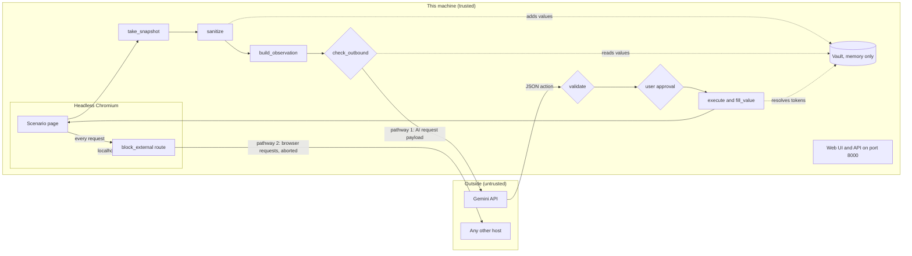

# Architecture

PrivacyLens is a browser agent that computes what is sensitive on this machine and sends the AI only a sanitized view of the page. Real values stay in a memory-only vault and are typed into the page locally.

## Data flow

## Trust boundaries
- Page content is untrusted, even though it is shown in a local browser. It may contain hidden instructions or try to send data out.
- The AI service is outside. It receives only what passes `check_outbound`, and its replies are untrusted until `validate` accepts them.
- The vault, the raw snapshot and the executor are trusted and local.
- The web UI and API are local, but the server listens on 0.0.0.0 with no authentication (see threat_model.md).

## The two covered transmission pathways
1. AI request payload. Built by `build_observation` from sanitized data only. `agent._step` runs `check_outbound` on the exact string (system prompt plus observation) before `LLM.next_action`. Any finding, vault value, canary or exception blocks the step.
2. Browser network requests. `block_external` routes every request of the browser context. Only localhost and data/blob/about URLs continue; everything else is aborted and the host is logged.

Leakage claims cover these two pathways and the tested scenarios only. See eval/results.json.

## One step
1. `take_snapshot` reads elements, text, aria tree, screenshot and sensitive text boxes.
2. `sanitize` replaces sensitive strings with `[REDACTED:TYPE#n]` and blacks out the screenshot.
3. `build_observation` creates the JSON the AI sees; secrets appear only as `{{TYPE#n}}` tokens.
4. `check_outbound` allows or blocks.
5. The AI replies with one JSON action.
6. `validate` checks target, field type, token use and literal values, and flags irreversible steps.
7. The user approves if needed.
8. `execute` acts; `fill_value` puts real values in at this point only.

## Module map
See docs/explain/ for one page per module.
