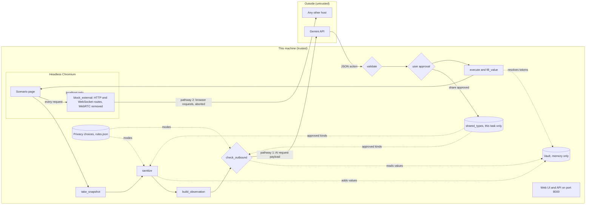
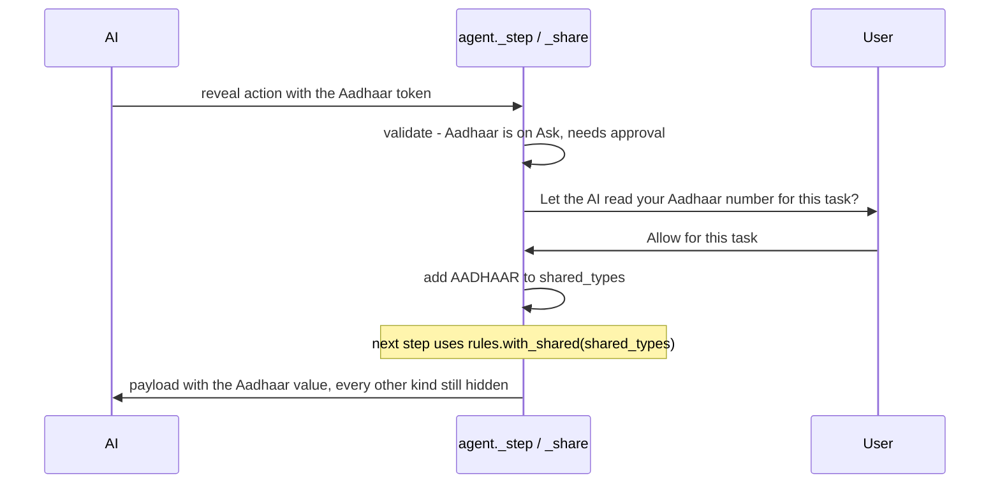
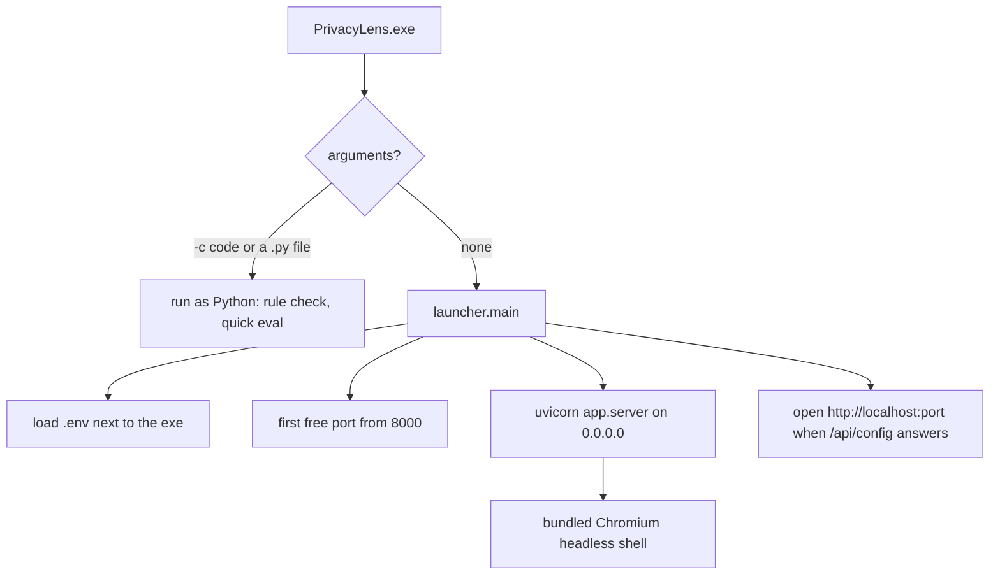

# Architecture

PrivacyLens is a browser agent that computes what is sensitive on this machine and sends the AI only a sanitized view of the page. Real values stay in a memory-only vault and are typed into the page locally. The user decides, per kind of data, whether it is hidden (Hide), hidden until they approve a request (Ask permission, the default), or readable by the AI (Reveal).

## Data flow

## Trust boundaries
- Page content is untrusted, even though it is shown in a local browser. It may contain hidden instructions or try to send data out.
- The AI service is outside. It receives only what passes `check_outbound`, and its replies are untrusted until `validate` accepts them.
- The vault, the raw snapshot and the executor are trusted and local.
- The web UI and API are local, but the server listens on 0.0.0.0 with no password so a phone can join. Settings, runs, the raw view and the leak test accept only requests from this machine; a Host header check accepts only localhost or a bare IP address, which refuses DNS rebinding (see threat_model.md). Approvals, including share approvals, can come from any device on the network.

## The two covered transmission pathways
1. AI request payload. Built by `build_observation` from sanitized data only. `agent._step` runs `check_outbound` on the exact string (system prompt plus observation) before `LLM.next_action`. Any finding, vault value, canary or exception blocks the step, except values and findings of the kinds the user shares (see below).
2. Browser network requests. `block_external` routes every HTTP request and every WebSocket of the browser context. Only localhost and data/blob/about URLs continue; everything else is aborted and only the site name is logged. WebRTC, which Playwright cannot route, is removed from every page by an init script, and Chromium runs with proxy-only WebRTC.

Leakage claims cover these two pathways and the tested scenarios only, with the default Privacy choices (every type on Ask permission, nothing approved). See eval/results.json.

## Privacy choices and the reveal exemption
- `rules.Rules.modes` maps every type to `redact`, `ask` or `reveal`. Every type defaults to `ask`. CUSTOM (the user's Always hide rules) always reads as `redact`.
- `Session.shared_types` holds kinds the user approved during the current task. It is in memory, never saved, and empty for every new task.
- Each step, `agent._step` builds `rules.with_shared(shared_types)` and passes it to the snapshot, sanitizer, observation, guard and validator. A change saved in Privacy choices, or a share approved in this step, takes effect from the next step.
- A kind is shared when its mode in that per-step copy is `reveal`. For a shared kind:
  - `find_sensitive` does not look for it, so the sanitizer leaves it in the text and draws no box over it;
  - `check_outbound` leaves its vault values out (`Vault.values(skip_types=...)`) and leaves it out of the pattern scan;
  - `validate` allows it in typed literal text.
- Every other kind, every canary and every Always hide match is handled as before. `<video>`, `<iframe>` and `<canvas>` are always boxed.
- The AI asks for an Ask kind with `{"action": "reveal", "value": "{{TYPE#n}}"}`. The validator rejects a Hide kind and an unknown token. For an Ask kind the user sees "Let the AI read your <name> for this task?" with "Allow for this task" and "Do not share". No or no answer stops the run.

## One step
1. `take_snapshot` reads elements (with a hidden flag), full and visible text, parent texts, aria tree, screenshot and sensitive text boxes.
2. `sanitize` replaces sensitive strings with `[REDACTED:TYPE#n]` (including values split over sibling tags), keeps only visible text, and blacks out the screenshot. Shared kinds are left as they are.
3. `build_observation` creates the JSON the AI sees (visible elements, sanitized page text and outline, history, `ask_kinds`); secrets appear only as `{{TYPE#n}}` tokens. The screenshot is not sent.
4. `check_outbound` allows or blocks.
5. The AI replies with one JSON action.
6. `validate` checks target (exists, visible), field type, token use and literal values, flags irreversible steps, and checks `reveal` requests against the modes. `agent._check` also rejects "done" before any step succeeded.
7. The user approves if needed: an action, or a share.
8. `execute` acts; `fill_value` puts real values in at this point only. A share adds the kind to `shared_types` instead.

## UI additions
- "Privacy choices" link next to "How it works", shown only when the page is opened as localhost on the computer. It opens a panel with rows grouped Identity, Payments, Login, Contact and Other, each with a Hide / Ask permission / Reveal control, plus the Always hide rules. A choice is saved at once (`PUT /api/rules`). Reveal asks for confirmation first.
- Hidden-item banner: when new items are hidden during a run, a pill drops in from the top. It is driven by the `hidden` list in `GET /api/session`; items already hidden when the page loads do not trigger it.

## Windows bundle
- `packaging/build_exe.bat` runs PyInstaller with `packaging/privacylens.spec` (one-folder build), copies Playwright's Chromium headless shell into `dist\PrivacyLens\browsers`, copies `.env.example`, and zips the folder to `dist\PrivacyLens-windows.zip`.
- `packaging/launcher.py` is the entry point. It sets `PLAYWRIGHT_BROWSERS_PATH` to the bundled browsers, loads the `.env` next to the exe, picks the first free port from 8000 (or `PRIVACYLENS_PORT`), prints the PC and phone URLs, opens the browser when `/api/config` answers, and runs the same `app.server` app.
- The app starts helper processes with `sys.executable` (the custom-rule speed check, the quick eval). In the bundle that is `PrivacyLens.exe`, so the launcher checks its arguments first: `-c <code>` or a `.py` path is run as Python would, anything else starts the server.

## Module map
See docs/explain/ for one page per module.
