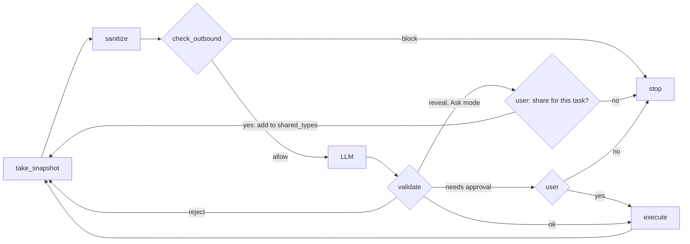

# agent.py

## What it does
Runs the loop: look at the page, sanitize, check, ask the AI, validate, maybe ask the user, act. It also holds all state for one run in `Session`.

## How
- `Session` creates a fresh `Vault`, loads the fake profile and canaries into it, wraps the planner in `RecordingLLM`, and keeps events, history, screenshots and the approval state. `start` opens a browser context with `block_external` and loads the scenario page. `close` closes it and clears the vault.
- `Session.rules` is the server's rules object itself, not a copy, so a choice saved in Privacy choices during a run is seen at the start of the next step.
- `Session.shared_types` holds the kinds the user approved for sharing during this task. It starts empty for every new session and is never saved. `Session.shared()` lists what the AI may read now, each marked `"by": "choice"` (set to Reveal) or `"by": "approval"` (approved in this task). The server sends this list to the UI for the status line.
- `_step` first builds `rules = session.rules.with_shared(session.shared_types)` and uses it for the snapshot, sanitizing, the observation, the guard and the validator. Then it takes a snapshot, sanitizes it, builds the observation, runs `check_outbound` on the full payload, calls the AI, parses and validates the reply.
- `_check` rejects `done` when no earlier step in history succeeded (premature done). It also rejects the first `ask_user` of a run with feedback that the secrets list and visible page are all the AI gets, so it takes the next visible step (for example signing in before the one-time code exists); a second `ask_user` stops the run with "the AI needs your help". Then it calls `validate`.
- Each "llm" audit event names the model that answered, for example "the AI answered (gemini-3.5-flash-lite)", so a fallback model is never used silently.
- `_share` handles an accepted `reveal` action. If the validator says approval is needed, it asks the user with `wording.share_question` and approval kind "share". A yes adds the kind to `shared_types` and logs "<name> shared for this task"; a no or no answer within 120 seconds stops the run ("stopped by you"). The share takes effect from the next step: the payload of the step that asked did not contain the value.
- `_act` asks for approval when the validator says so, then calls `execute`. Approval for typing is remembered per field type group (CARD and CVV share the "payment" group). Clicks that need approval ask every time. The narration and question text come from wording.py.
- `run` loops for up to `STEP_BUDGET` (12) steps. Any exception other than `LLMError` blocks the step and stops ("step failed safely"). `_check_success` reads `data-done` and `data-leak` flags that the fake pages set.
- `ask(question, why, kind)` waits up to 120 seconds for `answer`; no answer means no.
- `leak_test` sends a payload with a canary directly to the guard and reports whether it was blocked. The canary sits in a separate probe vault, so it never joins the live session's secrets, and no Privacy choice can exempt it.
- When a step fails, `_trace_summary` records the exception class and the last three frames (file, line, function), never the message.

## Likely judge questions
1. What happens if sanitizing throws? The exception is caught in `run`, the step is blocked and nothing is sent. The eval forces this case.
2. Why a step budget? To stop a confused or manipulated model from looping forever.
3. Is every audit message clean? `emit` passes every detail through `scrub`.
4. Who decides success? The fake page itself, through its `data-done` and `data-leak` attributes.
5. Is approval asked every time? For typing a secret, once per field group per session. For irreversible clicks, every time. For sharing a kind, once per task; a new task starts with nothing shared.
6. What if the AI says "done" straight away? `_check` rejects it until at least one step has succeeded; the rejection counts toward the 3-in-a-row limit.
7. Does rejecting the first "ask_user" weaken anything? No. The AI's next proposal still goes through the validator and the approval prompt, and a second "ask_user" stops the run.
8. Does an approved share cover one value or the whole kind? The whole kind, for the rest of the task. If the page shows two Aadhaar numbers, both reach the AI after a yes.
9. Can an approval leak into the next task? No. `shared_types` lives on the `Session`, and every task makes a new one (tests/test_choices.py::test_shared_types_do_not_carry_over_to_the_next_task).
