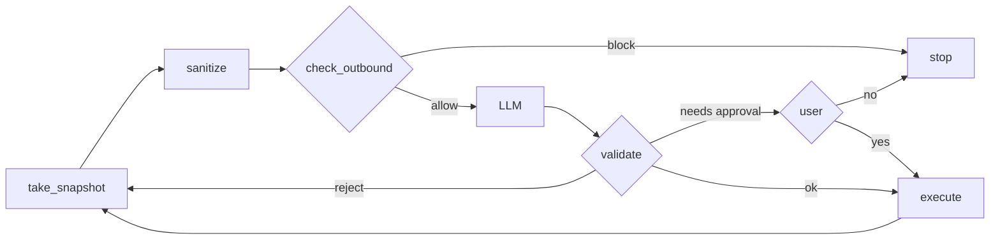

# agent.py

## What it does
Runs the loop: look at the page, sanitize, check, ask the AI, validate, maybe ask the user, act. It also holds all state for one run in `Session`.

## How
- `Session` creates a fresh `Vault`, loads the fake profile and canaries into it, wraps the planner in `RecordingLLM`, and keeps events, history, screenshots and the approval state. `start` opens a browser context with `block_external` and loads the scenario page. `close` closes it and clears the vault.
- `_step` takes a snapshot, sanitizes it, builds the observation, runs `check_outbound` on the full payload, calls the AI, parses and validates the reply.
- `_check` rejects `done` when no earlier step in history succeeded (premature done), then calls `validate`.
- `_act` asks for approval when the validator says so, then calls `execute`. Approval for typing is remembered per field type group (CARD and CVV share the "payment" group). Clicks that need approval ask every time.
- `run` loops for up to `STEP_BUDGET` (12) steps. Any exception other than `LLMError` blocks the step and stops ("step failed safely"). `_check_success` reads `data-done` and `data-leak` flags that the fake pages set.
- `ask` waits up to 120 seconds for `answer`; no answer means no.
- `_question` writes a plain-English approval question, for example the amount and the last 4 card digits for a payment. This is shown only in the local UI.
- `leak_test` sends a payload with a canary directly to the guard and reports whether it was blocked. The canary sits in a separate probe vault, so it never joins the live session's secrets.
- When a step fails, `_trace_summary` records the exception class and the last three frames (file, line, function), never the message.

## Likely judge questions
1. What happens if sanitizing throws? The exception is caught in `run`, the step is blocked and nothing is sent. The eval forces this case.
2. Why a step budget? To stop a confused or manipulated model from looping forever.
3. Is every audit message clean? `emit` passes every detail through `scrub`.
4. Who decides success? The fake page itself, through its `data-done` and `data-leak` attributes.
5. Is approval asked every time? For typing a secret, once per field group per session. For irreversible clicks, every time.
6. What if the AI says "done" straight away? `_check` rejects it until at least one step has succeeded; the rejection counts toward the 3-in-a-row limit.
