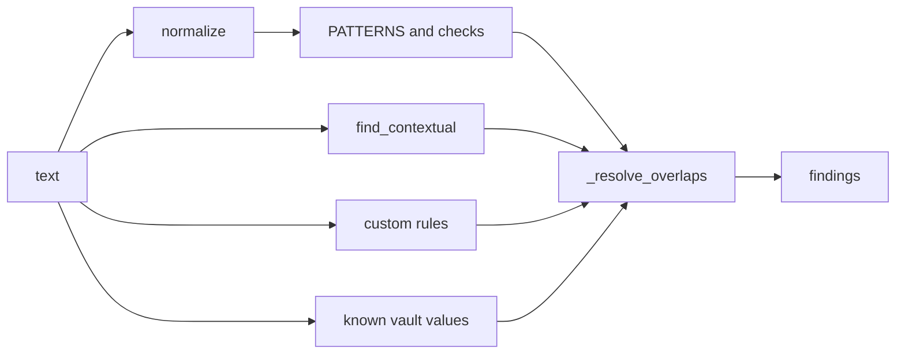

# detectors.py

## What it does
Finds sensitive values in a piece of text and returns them as `Finding` objects (type, start, end, value, reason, source). Everything runs locally with regular expressions and checksums. No model is involved.

## How
- `normalize` applies Unicode NFKC and drops zero-width characters. It keeps a map from each output character back to its original offset, so a match in the cleaned text can be cut out of the original text.
- `PATTERNS` is an ordered list of `Pattern` entries: CARD, AADHAAR, PAN, API_KEY (known prefixes, JWT shape, long random string next to "key", "token" or "secret"), PASSWORD, EMAIL, UPI, IFSC, IP_ADDRESS (v4 and v6), PHONE (Indian mobile and international), CVV, OTP.
- Some patterns have a `check` function that must also pass: `_card_ok` (13 to 19 digits and `luhn_valid`), `_aadhaar_ok` (12 digits, first digit 2 to 9, `verhoeff_valid`), `_is_ip` (Python `ipaddress`), `_key_ok` (Shannon entropy at least 3.5, mixes letters and digits).
- `find_sensitive` runs every pattern whose type is hidden, that is `rules.on(type)` is True (`_scan`), then `find_contextual` from context_rules.py (same filter), then the user's custom regexes (`_custom_findings`; CUSTOM always reads as hidden), then values already in the vault (`_known_findings`; values of 5 characters or more; CVV and EXPIRY skipped). A type the user set to Reveal, or approved for the current task, is not looked for at all. Saved values of that type are skipped too; canaries never are.
- `_known_findings` compares a compact form: lower case, letters and digits only (`compact`, `compact_value`). Spacing, punctuation, case and zero-width characters cannot hide a saved value. There is no word-boundary check, so a saved value is also found inside a longer word.
- `_resolve_overlaps` keeps one finding per region. Earlier types in `PATTERNS` win; within a type, the longer match wins.

## Likely judge questions
1. Why Verhoeff for Aadhaar and Luhn for cards? Card numbers use the Luhn check digit. Aadhaar uses Verhoeff. Checking the digit cuts false positives on random long numbers.
2. How do you handle a card written with spaces or full-width digits? The digit patterns allow any single symbol between digits (`SEP` is `[\W_]`); the checksums keep dates and amounts out. `normalize` turns full-width digits into ASCII and removes zero-width characters first.
3. What happens when two rules match the same text? `_resolve_overlaps` picks by the order of `PATTERNS`, then by length. For example CARD beats PHONE.
4. Does it hide things that are not sensitive? Yes, sometimes. A version string such as 1.2.3.4 is a valid IPv4 address and is hidden. The word "code" followed by 4 to 8 digits (for example a postal code) is treated as an OTP. See eval/results.json for measured precision.
5. What happens to a type the user reveals? `find_sensitive` skips it, so it is neither replaced in the text nor boxed in the screenshot. This covers every value of that type on the page, not only the user's own.
6. What is `source` for? "pattern" findings are format-based evidence; guard.py and scrub.py act only on those. "context" covers keyword rules and saved vault values (reason "a detail you saved earlier"); scrub.py also hides those saved-value findings.
