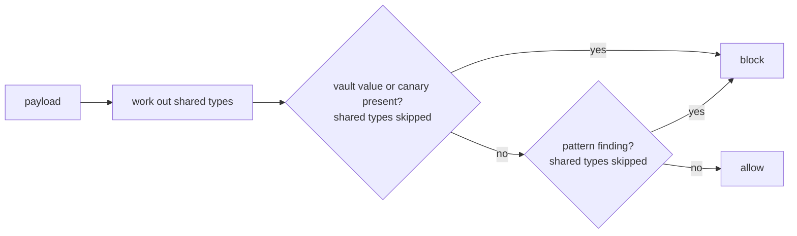

# guard.py

## What it does
The last check before a payload goes to the AI service. It allows or blocks the string. It fails closed: any exception means block. Only kinds of data the user chose to share may pass; canaries and Always hide matches never do.

## How
`check_outbound(payload, vault, rules)`:
1. Works out `shared`: every type for which `rules.on(type)` is False, that is, set to Reveal or approved for this task. With the default settings (every type on Ask, nothing approved) this set is empty.
2. Decodes JSON escapes such as ` ` or `​` (`decoded`), then normalizes both the raw and the decoded payload (same `normalize` as the detectors) and builds a compact copy of each: lower case, letters and digits only (`compact` from detectors.py).
3. For every value in `vault.values(skip_types=shared)` (saved details, everything hidden this session, canaries; values of shared types left out) it calls `_contains`. Values shorter than 6 characters, such as a CVV, need a whole-word match so they do not hit inside ids. Longer values match raw or compact.
4. Runs `find_sensitive` on a fresh `Rules` that carries only the user's custom rules, with the shared types set to reveal (`Rules(custom=...).with_shared(shared)`). Every other type is on, whatever the saved modes say. Any "pattern" finding blocks.
5. All of this sits in `try/except Exception`; an error returns a block.

The reason string never contains the value.

## Likely judge questions
1. If the sanitizer works, why a guard? Defence in depth. If a bug or a new code path skips the sanitizer, the guard still sees the final string. The UI leak test sends a canary straight to the guard to show this.
2. How are canaries caught? By exact or compact substring match, after JSON escapes are decoded. Spacing, punctuation, case and zero-width characters do not hide them. A reworded, base64-encoded or split canary would not be caught by this step. Sharing a type never exempts a canary: `Vault.values` always returns them.
3. How does the exemption stay limited to one type? Shared types are left out of the scan before it runs, not filtered from the results afterwards. If a shared match overlapped a hidden one, filtering afterwards could let the hidden one win the overlap and then be thrown away; scanning without the shared type cannot. tests/test_choices.py::test_reveal_lets_the_value_through_sanitize_and_guard checks that a revealed Aadhaar passes while a PAN in the same payload still blocks.
4. Can Always hide rules be exempted? No. `Rules.mode("CUSTOM")` is always `redact`, so CUSTOM is never in `shared` (tests/test_detectors.py::test_custom_rules_stay_hidden_even_if_custom_is_marked_reveal).
5. Why ignore "context" findings? They would block ordinary text. Values they found are already in the vault and covered by step 3.
6. What does a block do? agent.py records the reason and stops the run. Nothing is sent.
7. Can it block by mistake? Yes. A short saved value, like a 3 digit CVV, that appears as a whole word elsewhere on the page will block the step.
