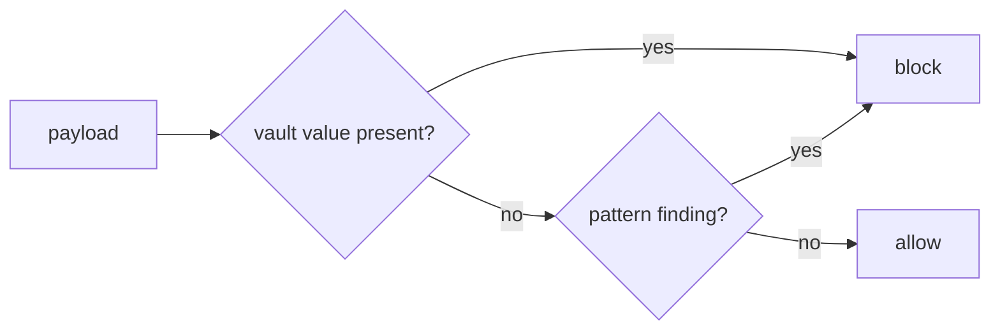

# guard.py

## What it does
The last check before a payload goes to the AI service. It allows or blocks the string. It fails closed: any exception means block.

## How
`check_outbound(payload, vault, rules)`:
1. Decodes JSON escapes such as `\u00a0` or `\u200b` (`decoded`), then normalizes both the raw and the decoded payload (same `normalize` as the detectors) and builds a compact copy of each: lower case, letters and digits only (`compact` from detectors.py).
2. For every value in `vault.values()` (saved details, everything hidden this session, canaries) it calls `_contains`. Values shorter than 6 characters, such as a CVV, need a whole-word match so they do not hit inside ids. Longer values match raw or compact.
3. Runs `find_sensitive` with every type on (only the user's custom rules carried over). Any "pattern" finding blocks.
4. All of this sits in `try/except Exception`; an error returns a block.

The reason string never contains the value.

## Likely judge questions
1. If the sanitizer works, why a guard? Defence in depth. If a bug or a new code path skips the sanitizer, the guard still sees the final string. The UI leak test sends a canary straight to the guard to show this.
2. How are canaries caught? By exact or compact substring match, after JSON escapes are decoded. Spacing, punctuation, case and zero-width characters do not hide them. A reworded, base64-encoded or split canary would not be caught by this step.
3. Why ignore "context" findings? They would block ordinary text. Values they found are already in the vault and covered by step 2.
4. What does a block do? agent.py records the reason and stops the run. Nothing is sent.
5. Can it block by mistake? Yes. A short saved value, like a 3 digit CVV, that appears as a whole word elsewhere on the page will block the step.
