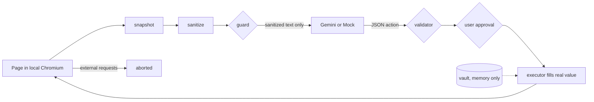

# Slides outline

Eleven slides. Every number comes from eval/results.json; the JSON key is in brackets. Refresh the numbers after the final eval run.

## 1. The problem

- AI browser agents read the whole page and send it to a cloud model.
- That page holds card numbers, OTPs, passwords, IDs, API keys, faces.
- A malicious page can also hide instructions for the agent.
- Users have no view of what was sent.

Speaker note: Start with the checkout page. Ask the room who would let a cloud model read their card number to buy a book.

## 2. Our principle

- Compute what is sensitive locally.
- Reason globally only on sanitized data.
- Real values stay in a memory-only vault and are typed in locally.
- The AI is useful without ever knowing a secret.

Speaker note: Everything after this slide is one way of enforcing this sentence.

## 3. Architecture

- Two covered pathways: the AI payload and browser network requests.
- Page and AI reply are both untrusted.
- Plain Python loop, no agent framework.

Speaker note: Point at the two arrows that leave the machine. One goes through the guard. The other is blocked.

## 4. Detection, defence in depth

- Regex plus checksums: card (Luhn), PAN, Aadhaar, phone, email, IP, API keys.
- Keyword context: OTP near "code", password in a sentence.
- Structure: field types, video call tiles, saved vault values.
- Face detection on the screenshot.
- Normalization defeats zero-width characters, full-width digits, split lines and odd separators; values split across tags are found in the parent text.

Speaker note: Then the guard checks the final string again. Two independent layers have to fail for a leak.

## 5. Sanitization, before and after

- Secrets become placeholders like `[REDACTED:CARD#1]` in text.
- The screenshot gets solid black boxes over sensitive text, fields, video and faces.
- "See what the AI sees" switch flips between the two views.
- How it works panel shows raw snapshot next to the exact outbound text.

Speaker note: Show the switch live. Mention honestly that the blacked-out screenshot is produced but the model receives text only.

## 6. AI reasoning, validation, approval

- The AI answers with one JSON action per step.
- The validator rejects unknown actions, missing targets, wrong-field tokens, guessed secrets, off-site URLs.
- Pay, submit, send, verify and similar clicks need the user's OK, every time, even with lookalike letters in the label.
- Typing a card, CVV, password or OTP needs the user's OK.
- "done" before any real step is rejected. 12 step budget, stop after 3 rejections in a row.
- The AI can ask to read a hidden kind (`reveal`), only if the user set it to Ask permission; the user decides, for one task.

Speaker note: The approval sheet works from a phone on the same Wi-Fi. First answer wins.

## 7. Local secret injection

- The AI sees `{{CARD#1}}`, never the number.
- It answers "type `{{CARD#1}}` into the card field".
- `fill_value` swaps in the real value right before typing.
- Token type must match the field type.

Speaker note: This is how the agent finishes checkout while the model stays blind.

## 8. Security: injection and leak test

- Injection page hides instructions in display:none, off-screen and tiny text.
- Hidden text is not sent to the model at all.
- A gullible Mock tries to follow them: card pasted = false [`security.injection.card_pasted_into_feedback`], 3 attempts rejected [`security.injection.attempts_rejected_by_validator`].
- Adversarial cases: 20 of 20 pass [`security.passed`, `security.total`].
- Raw unsanitized page is blocked by the guard: true [`security.raw_page_blocked_by_guard`].
- Run leak test button: a canary sent straight to the guard is blocked.

Speaker note: The leak test skips the sanitizer on purpose. It shows the last line holds by itself.

## 9. Results

| Measure | Value | Key |
|---|---|---|
| Recall | 100.0% of 29 | `detection.recall_overall_pct`, `detection.items_checked` |
| Precision | 100.0%, 0 of 44 lookalikes hidden | `detection.precision_pct`, `detection.lookalikes_wrongly_hidden` |
| Task success (Mock) | 100.0% | `tasks.task_success_pct` |
| Task success (Gemini, 3 runs per scenario, official, before fallback) | 94.4%, 0 leaks | `gemini.task_success_pct`, `gemini.leaked_values_in_ai_payloads` |
| Gemini, separate benchmark (not in results.json) | 20/24 (83.3%) before fallback chain, 24/24 (100%) with it | eval/gemini_benchmark.txt |
| Leaked values in AI payloads | 0 | `tasks.leaked_values_in_ai_payloads` |
| Full step median / p95 | 1035.9 / 1172.6 ms | `performance.full_step` |
| Peak Python memory | 13.5 MB | `resources.peak_python_mb` |
| Chromium / WebKit | 100.0% success, 0 leaks each | `cross_browser` |

- Firefox skipped: it would not launch on our machine.
- Gemini is a measured rate, not 100%. Numbers are on our own scenarios, 2 pathways.
- The Gemini failures we measured were free-tier 429 rate limits; the model fallback chain targets those. The free-tier daily quota remains the ceiling.

Speaker note: Say the limits out loud before a judge asks.

## 10. We covered the whole problem statement

- 29 exposed without PrivacyLens, 0 with [`detection.baseline.secrets_exposed_without_privacylens`, `detection.baseline.secrets_exposed_with`].
- Tasks (status from docs/requirements_matrix.md):
  - A) Sensitive Information Detection: DONE, except AI-Based Detection PARTIAL (faces not measured, no NER). `detectors`, `structure`, `context_rules`, `faces`.
  - B) Privacy-Preserving Sanitization: DONE. `sanitizer`, `guard`.
  - C) AI Reasoning and Automation: DONE (Mock 100.0%, Gemini 94.4%). `agent`, `llm`, `validator`, `executor`.
  - D) Privacy and Security Validation: DONE, except retention PARTIAL (documented, not tested). `guard`, `scrub`, `executor.block_external`.
- Evaluation scenarios:
  - E-commerce checkout: card details and addresses. DONE
  - Authentication: passwords, emails, and OTPs. DONE
  - Customer support: phone numbers and private messages. DONE
  - Video conferencing: faces and participant information. PARTIAL (face blackout not measured)
  - Developer settings: API keys, tokens, and IP addresses. DONE
  - Plus our extra injection page.
- Evaluation criteria:
  - PII Detection Recall: DONE [`detection.recall_overall_pct`]
  - Redaction Precision: DONE [`detection.precision_pct`]
  - Privacy Leakage: DONE [`tasks.leaked_values_in_ai_payloads`]
  - Context Preservation: DONE [`tasks.task_success_pct`, `gemini.task_success_pct`]
  - Task Success: DONE [`tasks.task_success_pct`]
  - Performance: DONE [`performance`, `resources`]
  - Security: DONE [`security.passed`, `security.total`]
- Bonus points:
  - Fully local AI processing without cloud requests. PARTIAL (Mock only, no Ollama)
  - Advanced contextual PII detection. DONE
  - Adaptive redaction that preserves maximum useful context. DONE
  - Protection against prompt injection and adversarial webpages. DONE
  - User-defined privacy rules and explainable redaction. DONE
  - Local secret injection without exposing values to cloud models. DONE
  - Automated leakage testing using synthetic canary values. DONE
  - Cross-browser or desktop-agent support. PARTIAL (Chromium and WebKit, no Firefox)
  - Human approval for sensitive actions. DONE

Speaker note: End on the "29 without, 0 with" line. Then hand over to the demo.

## 11. Added: the user decides, and it installs in one click

- Privacy choices: each kind of data is Hide, Ask permission (default) or Reveal. Grouped Identity, Payments, Login, Contact, Other.
- Ask permission: the AI asks, the user sees "Let the AI read your Aadhaar number for this task?", "Allow for this task" or "Do not share". The yes is never saved.
- Reveal: the guard lets only that kind through. Canaries and Always hide rules stay blocked.
- Status line names what is shared: "Aadhaar number shared with your permission".
- Banner: "Card number hidden", with "Kept on this device" below, drops in when something new is hidden.
- Windows app: unzip, double-click `PrivacyLens.exe`, no Python. About 230 MiB zipped, about 570 MB unzipped, because it carries its own Chromium.
- Honest scope: the 0-leak numbers are for the default settings with nothing revealed. Gemini has not been run with the `reveal` action yet. The exe is unsigned (SmartScreen warns) and was run on our PC only.

Speaker note: Show the support task "Ask support to verify my Aadhaar number." with the Mock, approve the share, point at the status line. Then start a new task and show nothing is shared any more.
